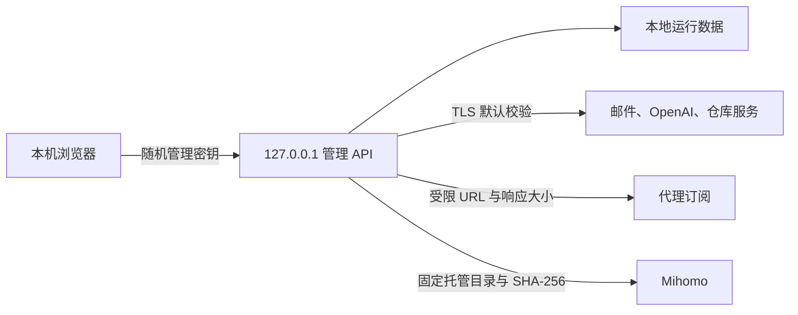

# 安全说明

## 默认边界

- 主服务仅监听 `127.0.0.1:8000`，管理 API 必须使用安装时随机生成的 `auth-key`。
- `config.json`、`data/`、`logs/`、`backups/` 和构建缓存均属于本地数据，不得提交或打包发布。
- 邮箱 webhook 在未配置独立 secret 时拒绝服务，请求正文上限为 5 MiB，日志不记录请求头、正文或 secret。
- 出站 HTTPS 默认校验证书。全局和仓库级“跳过 TLS 证书校验”仅用于可信内网自签名证书，不应在公网链路启用。
- 代理订阅仅接受 HTTP(S)，默认拒绝本机、私网、链路本地和带内嵌凭据的地址，并限制重定向和 5 MiB 响应。可信内网订阅必须显式启用“允许访问可信内网订阅地址”。
- Plus Engine 的本地运行密钥只向回环客户端返回；托管 Mihomo 只能执行托管运行目录中的 `mihomo.exe`，自动下载要求发布资产提供并通过 SHA-256 摘要校验。
- pnpm 构建脚本只对白名单中的 `sharp` 和 `unrs-resolver` 开放，其余依赖不能在安装阶段执行脚本。

## 信任边界



## 发布前检查

公开版本必须从白名单复制到新目录并重新初始化 Git，不能复用包含历史 `config.json` 的原仓库历史。至少执行：

```powershell
python -m unittest discover -s tests
python -m compileall -q api services scripts utils main.py serve_local.py
cd web
corepack pnpm install --frozen-lockfile
corepack pnpm audit --prod
corepack pnpm typecheck
corepack pnpm build
```

发布包中不得存在 `.git` 历史迁移、`config.json`、真实账号、token、邮箱、代理凭据、日志、抓包或临时报告。
